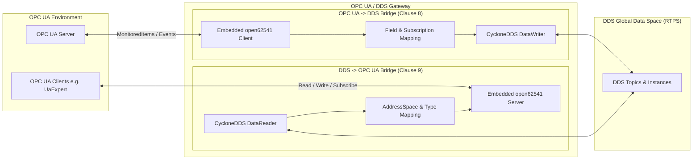

# OMG OPC UA / DDS Gateway (formal/20-01-01)

A standard-compliant C++ implementation of the OMG specification **OPC UA / DDS Gateway Version 1.0** ([docs/formal-20-01-01.pdf](file:///c:/Users/ckahr/coding/opcua_dds_gateway/docs/formal-20-01-01.pdf)).

---

## 🏛️ Architecture Overview

The gateway provides a seamless, vendor-independent bridge between the OPC UA industrial automation domain and the Data Distribution Service (DDS) Global Data Space (RTPS):



### 1. DDS to OPC UA Bridge (Clause 9)
* **Embedded OPC UA Server:** Powered by `open62541`. The gateway hosts its own OPC UA server (default: `opc.tcp://0.0.0.0:4840`). External OPC UA clients (like **UaExpert**) connect directly without needing any third-party OPC UA server.
* **AddressSpace Model (§9.3):**
  * `Domain_<DomainId>` (Object of `DomainType`, includes mandatory `DomainId` property).
  * `<TopicName>` (Object of `TopicType`, includes `RegisteredTypeName` property).
  * `Instance_<InstanceId>` (for keyed topics) or `Instance` (for unkeyed topics).
  * **Standard SampleInfo Metadata (§9.3.4.1 Table 9.52):**
    * `SampleState` (`READ` / `NOT_READ`)
    * `ViewState` (`NEW` / `NOT_NEW`)
    * `InstanceState` (`ALIVE` / `NOT_ALIVE_DISPOSED` / `NOT_ALIVE_NO_WRITERS`)
    * `SourceTimestamp` (OPC UA `DateTime` converted from DDS `Time_t`)
    * `InstanceHandle` (string representation of the DDS instance key)
    * `ValidData` (`Boolean`)
  * **Payload Variables:** Variables representing DDS type members (e.g. `color`, `x`, `y`, `shapesize` for `ShapeType`). Key members are strictly read-only (`WriteMask = 0`) as per §9.2.8.
* **Dynamic Node Creation & Discovery:**
  * In addition to pre-configured instances, any newly arriving DDS instance (e.g. a publisher publishing `color="YELLOW"`) is **dynamically detected and created in the AddressSpace on the fly** (§9.3.4.1).
  * OPC UA clients can also call the `RegisterInstance` method to dynamically instantiate new instances (§9.3.4.6).
* **Bi-directional Data Flow:**
  * Incoming DDS samples automatically update OPC UA variable values and SampleInfo attributes in real-time.
  * Writes by OPC UA clients to non-key variables trigger DDS `DataWriter::write()` to propagate changes over RTPS.

### 2. OPC UA to DDS Bridge (Clause 8)
* **Embedded OPC UA Client:** Powered by `open62541`. Connects to external OPC UA servers.
* **Subscription Model Mapping (§8.4):**
  * Creates Subscriptions and `MonitoredItem`s for configured `data_item`s.
  * Dispatches `DataChangeNotification` events according to `InputOutputMapping`.
  * Aggregates fields and publishes compiled samples via Cyclone DDS `DataWriter`.

### 3. XML Configuration Parser (Clause 10)
* Full parsing support for Chapter 10 XML configuration files using `pugixml` ([configs/gateway_shape_example.xml](file:///c:/Users/ckahr/coding/opcua_dds_gateway/configs/gateway_shape_example.xml) and [configs/gateway_server_dds2opcua.xml](file:///c:/Users/ckahr/coding/opcua_dds_gateway/configs/gateway_server_dds2opcua.xml)).

---

## 🛠️ Technology Stack

* **Language:** Modern C++17
* **DDS Middleware:** Eclipse [Cyclone DDS](https://cyclonedds.io) (`cyclonedds` / `cyclonedds-cxx` 0.10.5)
* **OPC UA Stack:** [open62541](https://open62541.org) (v1.4.6)
* **XML Parser:** [pugixml](https://pugixml.org) (v1.14)
* **Package Management:** Conan 2.x
* **Build System:** CMake 3.20+ with MSVC (Visual Studio 2022)

---

## 🚀 Build Instructions

### 1. Install Dependencies via Conan 2
```powershell
conan install . --build=missing
```

### 2. Configure and Build via CMake
```powershell
cmake --preset conan-default
cmake --build --preset conan-release
```

### 3. Run Automated Tests
```powershell
.\build\Release\gateway_tests.exe
```

---

## 🔬 Testing with UaExpert

The gateway runs an embedded OPC UA server, allowing client software like **UaExpert** to connect directly.

### Step 1: Start the Gateway Server (Terminal 1)
```powershell
.\build\Release\opcua_dds_gateway.exe -c configs/gateway_server_dds2opcua.xml
```
Output:
```text
[DdsToOpcUaBridge] Initializing embedded open62541 server on port 4840...
[DdsToOpcUaBridge] Initializing DDS DomainParticipant (domain 0)...
[DdsToOpcUaBridge] Setting up Topic in AddressSpace: Circle
[DdsToOpcUaBridge] Pre-registering instance: BLUE
[DdsToOpcUaBridge] Pre-registering instance: RED
[DdsToOpcUaBridge] OPC UA Server listening on opc.tcp://0.0.0.0:4840
[Gateway] Gateway started and processing traffic.
```

### Step 2: Connect with UaExpert
1. Open **UaExpert**.
2. Click **Add Server (+)**.
3. Enter endpoint URL: `opc.tcp://localhost:4840`.
4. Security Policy: `None - None (uatcp-uasc-uabinary)`.
5. Authentication: `Anonymous`.
6. Right-click the server and choose **Connect**.

### Step 3: Browse the Normative AddressSpace
Navigate the tree:
```text
Root
 └── Objects
      └── Domain_0                   (DomainType, DomainId = 0)
           └── Circle                 (TopicType, RegisteredTypeName = ShapeType)
                ├── Instance_BLUE     (DDS Topic Instance)
                │    ├── color        ("BLUE", Read-only key)
                │    ├── x            (Int32)
                │    ├── y            (Int32)
                │    ├── shapesize    (Int32)
                │    ├── InstanceState ("ALIVE")
                │    ├── SampleState   ("NOT_READ" / "READ")
                │    ├── ViewState     ("NEW" / "NOT_NEW")
                │    ├── SourceTimestamp (OPC UA DateTime)
                │    └── ValidData     (true)
                └── Instance_RED
```
Drag `Instance_BLUE` into the **Data Access View** (or the History Trend view).

### Step 4: Inject Live DDS Samples (Terminal 2)
Run the bundled Cyclone DDS shape publisher:
```powershell
.\build\Release\dds_shape_publisher.exe BLUE
```
This publishes moving coordinates over DDS RTPS:
```text
[RTPS Sample Sent] color=BLUE | x=148 | y=174 | size=30
```
In UaExpert, you will see `x`, `y`, and `SourceTimestamp` **updating in real time** every 100ms!

### Step 5: Test Dynamic Node Discovery on the Fly
Run the publisher with a new color that was not in the configuration:
```powershell
.\build\Release\dds_shape_publisher.exe YELLOW
```
In UaExpert, right-click `Circle` and select **Re-Browse** (or collapse and re-expand):  
`Instance_YELLOW` is **created dynamically at runtime** with all variables and metadata!
